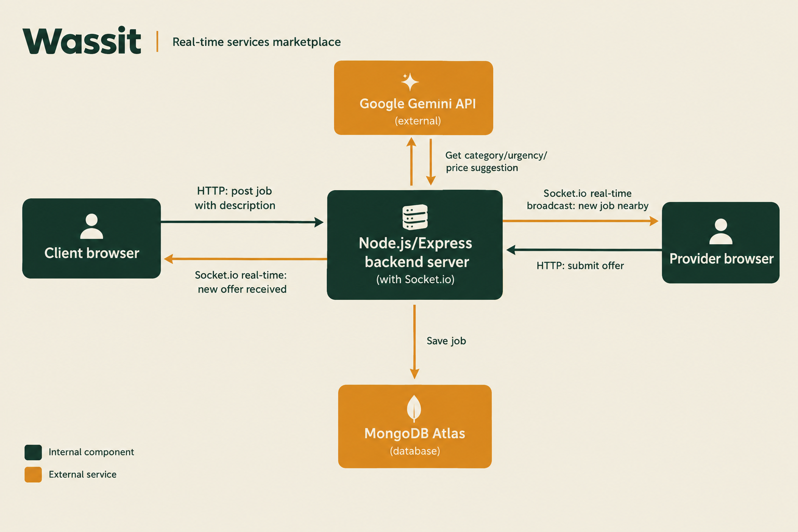
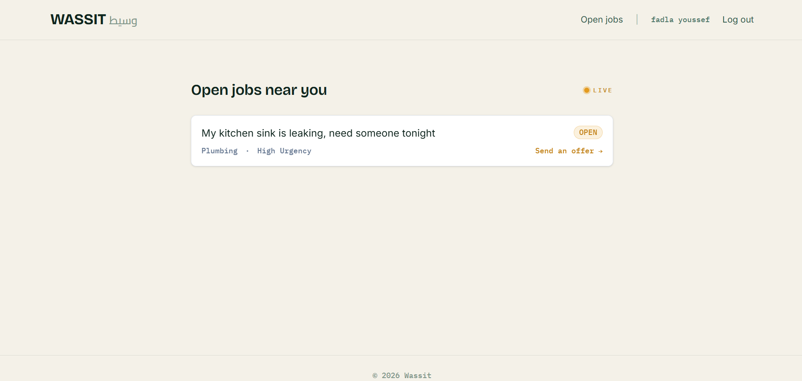
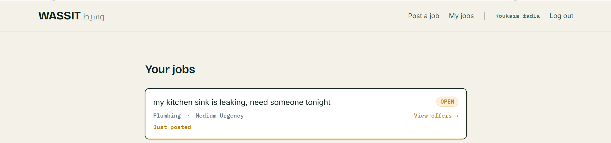
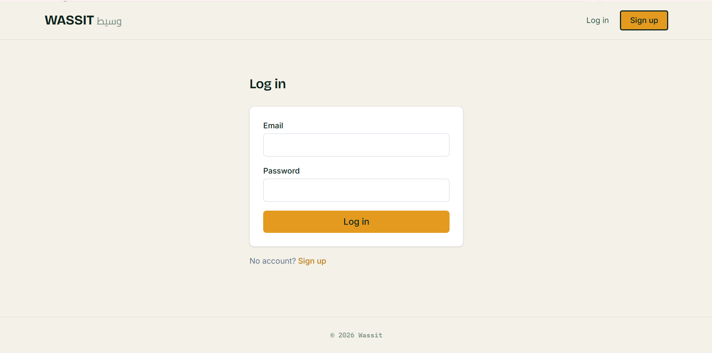
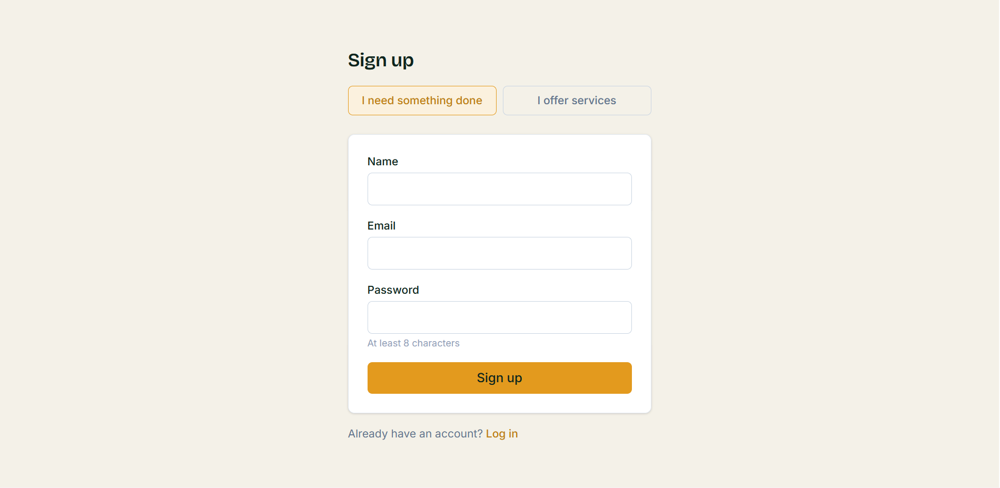
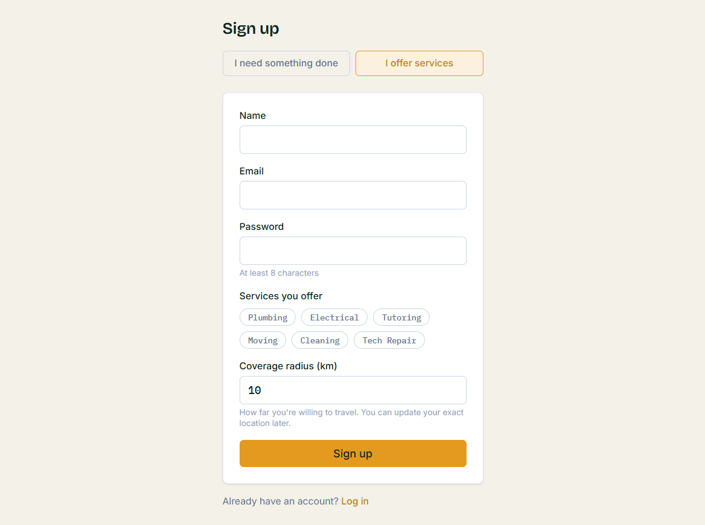

 <div align="center">


# Wassit (وسيط)

**A hyperlocal services marketplace connecting clients with nearby service providers.**

Describe what you need. Get offers from nearby providers. Compare prices and choose the right person for the job.

[Live Application](https://wassit-omega.vercel.app/) · [GitHub Repository](https://github.com/roukaiafadla/wassit)

</div>

---

## Overview

Wassit (وسيط) makes finding local services simpler. Instead of filling out lengthy forms or browsing through categories, clients describe what they need in their own words. AI helps identify the service category, urgency, and estimated price range, while clients remain in control of the final details.

Once a job is published, nearby providers receive it in real time and can submit offers with their proposed prices and estimated arrival times. Clients can compare offers, choose a provider, and communicate directly through the platform.

From job creation to provider selection, Wassit brings service discovery, real-time interaction, and community trust into one place.

## Features

### AI-Assisted Job Posting

- Create jobs using natural-language descriptions.
- Generate suggested categories, urgency levels, and price ranges with Google Gemini.
- Review and edit AI suggestions before publishing.
- Fall back to keyword-based classification when the AI service is unavailable.

### Location-Based Matching

- Connect clients with relevant nearby service providers.
- Match jobs using location and service category.
- Deliver relevant job updates without relying on manual refreshes.

### Real-Time Job Feed and Offers

- Broadcast new jobs using Socket.IO.
- Let providers submit offers with pricing and estimated arrival times.
- Update incoming offers in real time.
- Allow clients to compare offers and select their preferred provider.

### Authentication and User Roles

- JWT-based registration and login.
- Separate client and provider workflows.
- Role-based access for clients, providers, and administrators.

### Chat and Reviews

- Real-time messaging between clients and selected providers.
- Typing indicators and read receipts.
- Reviews and ratings after completed jobs.
- Updated provider ratings to support trust and accountability.

### Admin Dashboard

- Monitor platform activity and statistics.
- Verify service providers.
- Manage users and handle disputes.
- Receive real-time notifications for relevant administrative events.

## Architecture

<div align="center">
  
</div>

Wassit uses a React frontend backed by a Node.js API, with MongoDB for persistent storage and Socket.IO for real-time communication. Google Gemini powers AI-assisted job analysis, with a keyword-based fallback to keep job creation available when AI requests fail.

## Screenshots

### Live Job Feed

<div align="center">
  
</div>

### My Jobs

<div align="center">
  
</div>

### Login

<div align="center">
  
</div>

### Registration

<div align="center">
  
  
</div>

## Tech Stack

| Technology | Role |
|---|---|
| React | Frontend UI |
| Vite | Development server and build tooling |
| Tailwind CSS | Styling |
| Node.js | Backend runtime |
| Express | REST API |
| MongoDB Atlas | Database |
| Socket.IO | Real-time communication |
| JWT | Authentication |
| Google Gemini API | AI-assisted job analysis |
| Vercel | Frontend deployment |
| Render | Backend deployment |

## Getting Started

### Prerequisites

- Node.js and npm
- Git
- A MongoDB database or MongoDB Atlas account
- A Google Gemini API key

### 1. Clone the repository

```bash
git clone https://github.com/roukaiafadla/wassit.git
cd wassit
```

### 2. Set up the backend

```bash
cd backend
npm install
```

Create a `.env` file based on `backend/.env.example` and configure the required environment variables:

```env
MONGODB_URI=your_mongodb_connection_string
JWT_SECRET=your_secure_jwt_secret
GEMINI_API_KEY=your_gemini_api_key
CLIENT_ORIGIN=http://localhost:5173
```

Use the variable names defined by the project's actual environment configuration.

Start the development server:

```bash
npm run dev
```

Backend: `http://localhost:5000`

### 3. Set up the frontend

Open another terminal from the repository root:

```bash
cd frontend
npm install
npm run dev
```

Frontend: `http://localhost:5173`

The development setup uses Vite's proxy to route API requests to the local backend.

### 4. Create the initial admin account

Run the seed script from the backend directory:

```bash
cd backend
npm run seed
```

The development seed account is:

- Email: `admin@wassit.dev`
- Password: `admin12345`

Change the default password and secure the account before using any production environment. Never expose seed credentials in a public production deployment.

## Deployment

The application is available at:

**[wassit-omega.vercel.app](https://wassit-omega.vercel.app/)**

| Service | Platform |
|---|---|
| Frontend | Vercel |
| Backend API | Render |
| Database | MongoDB Atlas |

The frontend and backend are deployed separately, with MongoDB Atlas providing persistent storage.

**Free-tier note:** If the backend uses a Render free instance, it may spin down after inactivity. The first request after a period of inactivity can take longer while the service starts up.

## Security

- Store secrets and API keys in environment variables.
- Keep `.env` files out of version control.
- Use a strong JWT secret.
- Enforce authorization on protected backend routes.
- Restrict production CORS to trusted frontend origins.
- Replace default administrative credentials before deployment.

## Contributing

Contributions and suggestions are welcome.

1. Fork the repository.
2. Create a branch for your changes.
3. Implement and test your changes.
4. Open a pull request describing your contribution.

## License

No license has been specified yet. Add a `LICENSE` file if you intend to publish Wassit under an open-source license.

---

<div align="center">

**Wassit — Connecting local needs with local services.**

[Explore the Live Application](https://wassit-omega.vercel.app/)

</div>